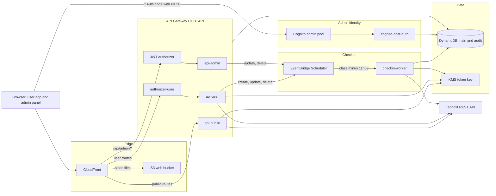
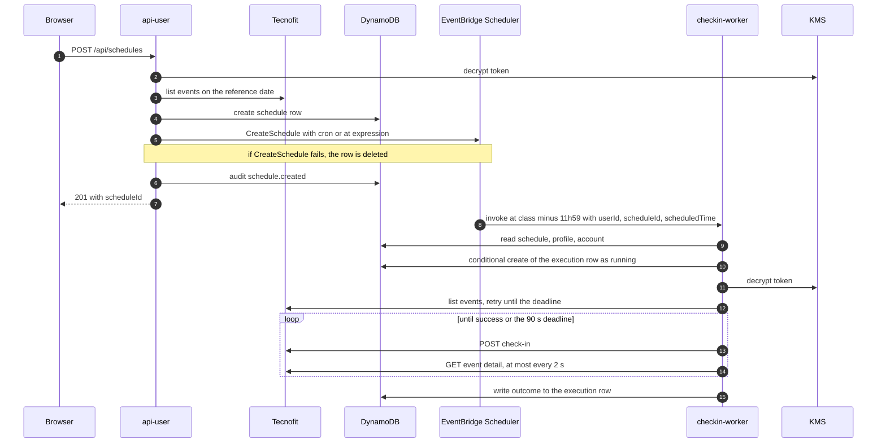
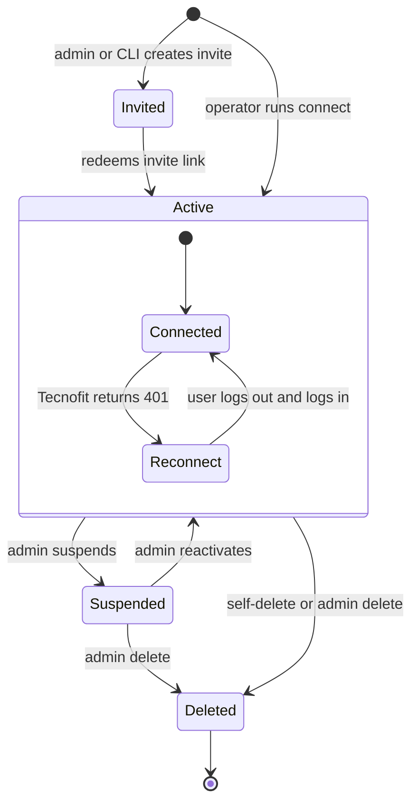
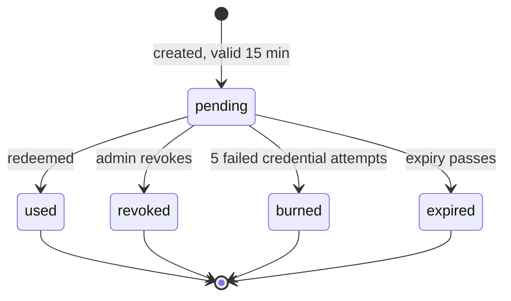

# Architecture

## Purpose

Tecnofit Auto Check-in checks users in to classes at a Tecnofit box automatically. Access is invite-only. A user connects their Tecnofit account, books a class once or weekly, and the system checks in when Tecnofit opens check-in. An admin manages invites, users, executions and the audit trail. Everything runs serverless on AWS in `us-east-1`.

## Glossary

| Term | Meaning |
| --- | --- |
| Box | The gym a user trains at. Stored as `boxName` on the account row. |
| Empresa | Tecnofit's numeric id for a box (`empresaId`). It comes from the `empresa_id` claim of the Tecnofit token and appears in Tecnofit API paths. |
| Class (aula) | A Tecnofit calendar event. The system identifies it by name and start (`YYYY-MM-DD HH:mm`). |
| Schedule (agendamento) | A user's booking: class name, start time, and either `weekly` weekdays or a `once` date. |
| Execution (execução) | One check-in run for one schedule and one class date. |
| Invite (convite) | A single-use onboarding link `/convite#<token>`, valid for 15 minutes. |
| Tecnofit token | The JWT that Tecnofit returns at login. Stored KMS-encrypted in `account.tokenEnc`. |
| Consent | The terms shown at onboarding (`apps/web/src/consent.ts`). The accepted `CONSENT_VERSION` is recorded in the `invite.redeemed` audit event. |
| Reconnect | Account status set when Tecnofit answers 401. The user fixes it by logging out and in again. |
| Waiting list (lista de espera) | Tecnofit's queue for a full class. The app never joins it ([ADR 0019](adr/0019-remove-waiting-list.md)). `waitlisted` appears only on older executions. |

## Components



CloudFront adds the secret `X-Origin-Verify` header to every `/api/*` request. Every Lambda logs to CloudWatch; metric filters and alarms notify an SNS email topic (see [Observability](#observability)).

| Name | Kind | Responsibility | Code path |
| --- | --- | --- | --- |
| Web SPA | React app built by Vite | User app, invite onboarding and admin panel | `apps/web` |
| CloudFront `checkin-<env>` | CDN | Serves the SPA, proxies `/api/*`, injects `X-Origin-Verify`, sets CSP and security headers | `infra/modules/frontend/main.tf` |
| S3 web bucket | Object storage | Holds the built SPA, read through origin access control | `infra/modules/frontend/main.tf` |
| API Gateway `checkin-<env>-api` | HTTP API | Routes `/api/*` to Lambdas and runs authorizers | `infra/modules/backend/main.tf`, `infra/modules/auth/main.tf` |
| `api-public` | Lambda (Hono) | Health, invite check, onboarding, login | `apps/functions/api-public/index.ts` |
| `authorizer-user` | Lambda REQUEST authorizer | Checks the origin header and resolves the `sid` cookie to a session | `apps/functions/authorizer-user/index.ts` |
| `api-user` | Lambda (Hono) | Profile, logout, self-delete, classes, schedules, executions | `apps/functions/api-user/index.ts` |
| `api-admin` | Lambda (Hono) | Invites, users, executions by date, audit query and CSV export | `apps/functions/api-admin/index.ts` |
| `checkin-worker` | Lambda | Runs one check-in per Scheduler invocation | `apps/functions/checkin-worker/index.ts`, `packages/core/domain/checkin.ts` |
| `cognito-post-auth` | Lambda Cognito trigger | Writes the `admin.login` audit event | `apps/functions/cognito-post-auth/index.ts` |
| Cognito pool `checkin-<env>-admin` | Identity provider | Admin login with TOTP MFA and the `admin` group | `infra/modules/auth/main.tf`, `apps/web/src/admin/auth.ts` |
| JWT authorizer `checkin-<env>-authorizer-admin` | API Gateway authorizer | Validates Cognito access tokens on `/api/admin/*` | `infra/modules/auth/main.tf` |
| DynamoDB `checkin-<env>-main`, `checkin-<env>-audit` | Tables with TTL and PITR | Single-table data and the audit trail | `packages/core/db/entities.ts`, `infra/modules/data/main.tf` |
| KMS `alias/checkin-<env>-token` | Key | Encrypts Tecnofit tokens | `packages/core/crypto/token.ts`, `infra/modules/data/main.tf` |
| Scheduler group `checkin-<env>` | EventBridge Scheduler | One schedule per booking that invokes the worker | `packages/core/domain/schedules.ts`, `infra/modules/backend/main.tf` |
| SNS `checkin-<env>-alarms` | Topic | Sends CloudWatch alarms to `<alarm-email>` | `infra/modules/backend/main.tf` |
| Tecnofit REST API | External service | Login, profile, class list, event detail, check-in | `packages/core/tecnofit/client.ts` |

Terraform in `infra/` defines the AWS infrastructure, and HCP Terraform applies it. Detail lives elsewhere: routes in [api.md](api.md) and [openapi.yaml](openapi.yaml), tables in [data-model.md](data-model.md), Tecnofit calls in [tecnofit-integration.md](tecnofit-integration.md), Terraform in [infrastructure.md](infrastructure.md), pipelines in [ci-cd.md](ci-cd.md).

## Monorepo layout

npm workspaces: `packages/*`, `apps/functions/*` and `apps/web`.

```text
packages/core/            @checkin/core: raw TypeScript shared by Lambdas, scripts and tests
  audit/audit.ts          write, query and CSV-export audit events
  crypto/secret.ts        random tokens and their SHA-256 hashes
  crypto/token.ts         KMS encrypt/decrypt with the userId encryption context
  db/entities.ts          ElectroDB entities on the main and audit tables
  db/table.ts             table definition used by the local env and tests
  domain/checkin.ts       runCheckin: the worker logic
  domain/invites.ts       create, list, revoke, check and redeem invites
  domain/migrate.ts       one-shot dev-to-prod user copy
  domain/schedules.ts     schedules and their EventBridge Scheduler entries
  domain/sessions.ts      login, sessions, lockout
  domain/time.ts          time zone, fire offset, cron/at expressions
  domain/users.ts         suspend, reactivate, delete, revoke sessions
  http/origin.ts          X-Origin-Verify check
  tecnofit/client.ts      Tecnofit HTTP client with zod-validated responses
apps/functions/<name>/    one Lambda per folder (index.ts exports handler)
apps/web/                 SPA (React, Vite, Tailwind v4)
scripts/                  operations CLI, local API gateway, Lambda build
infra/                    Terraform: bootstrap, envs/dev, envs/prod, modules/{auth,backend,data,frontend}
tests/                    unit, integration (moto), e2e (Playwright), fixtures
docs/                     this documentation
```

## Request path and security model

Every request enters through CloudFront over HTTPS.

1. Paths without a file extension are rewritten to `/index.html` by the CloudFront function `checkin-<env>-spa-rewrite`. Static files come from S3.
2. `/api/*` goes to API Gateway. CloudFront adds the secret `X-Origin-Verify` header and forwards cookies, query strings and a header allowlist.
3. Public routes go straight to `api-public`. User routes run `authorizer-user` first. `/api/admin/*` runs the Cognito JWT authorizer first.
4. The Lambda checks the origin header again, validates input with zod and calls `@checkin/core`.

Security controls:

- **Origin lock.** CloudFront injects a random secret as `X-Origin-Verify`. Every API Lambda and the authorizer compare it in constant time (`packages/core/http/origin.ts`). Direct calls to API Gateway are rejected.
- **User sessions.** The `sid` cookie holds a random token. DynamoDB stores only its SHA-256 hash as `sessionId`. Cookie attributes are in [api.md](api.md#student-session).
- **CSRF.** `SameSite=Strict` plus a required `X-Requested-With: fetch` header. See [api.md](api.md#csrf-rule).
- **Brute force.** Five failed logins for one e-mail lock it until 15 minutes after the first failure. Five failed credential attempts burn an invite. The API stage throttles all routes, with lower limits on public `POST` routes.
- **Admin.** Cognito with admin-created users only and TOTP MFA required. The SPA uses the authorization code flow with PKCE (S256) and a `state` check. `api-admin` also requires `admin` in the `cognito:groups` claim.
- **Tecnofit credentials.** The password is only forwarded to Tecnofit at login and is never stored. The token is KMS-encrypted with encryption context `{ userId }`. The key policy limits token use to the worker, `api-public`, `api-user` and the listed operators.
- **Invite tokens.** The token travels in the URL fragment, so it never reaches a server log. DynamoDB stores only its SHA-256 hash as `inviteId`.
- **Browser.** CSP is `default-src 'self'`, with `connect-src` adding only the Cognito domain. HSTS, `X-Frame-Options: DENY` and `Referrer-Policy: no-referrer` are also set.
- **Audit.** User and admin actions write events to the audit table, kept for 365 days. The worker writes no audit events.

## Check-in flow

`POST /api/schedules` writes the schedule and its Scheduler entry synchronously. There is no DynamoDB Stream.



The worker's step-by-step algorithm is in [tecnofit-integration.md](tecnofit-integration.md#check-in-worker). Execution statuses and error codes are in [data-model.md](data-model.md#execution).

Timing rules:

- Tecnofit opens check-in 12 h before any class. The job fires at class − 11h59 (`FIRE_BEFORE_CLASS_MIN = 719` in `packages/core/domain/time.ts`).
- Expressions use time zone `America/Sao_Paulo` and `FlexibleTimeWindow` `OFF`.
- Weekly bookings use `cron(m h ? * DAYS *)`. One-off bookings use `at(YYYY-MM-DDTHH:mm:00)` with `ActionAfterCompletion: DELETE`.
- A class before 11:59 fires on the previous day, so cron weekdays shift back by one. A Monday 07:00 class fires Sunday 19:01.
- A one-off booking is refused unless the class starts more than 11 h 59 min from now (`TooLate`).
- The worker derives the class slot from `scheduledTime` plus 719 minutes (`classSlotFor`).
- Scheduler retries are 0 and the maximum event age is 60 s. The worker's async invoke config uses the same values.
- The worker stops at 90 s. Its Lambda timeout is 120 s. Each Tecnofit request times out after 5 s.

## User lifecycle

No profile exists before an invite is redeemed. Onboarding creates the profile, the account and the first session in one transaction. The operator script `npm run connect` can also create a profile without an invite.



- **Reconnect.** Login rewrites the encrypted token and sets the account back to `ok`. The UI sends the user through logout to `/login`.
- **Suspend.** Sets the profile to `suspended`, revokes all sessions and disables active schedules with `pausedBySuspension`. A suspended user cannot log in.
- **Reactivate.** Sets the profile to `active` and re-enables only the schedules paused by the suspension.
- **Delete.** Removes Scheduler entries, schedules, executions, accounts, the profile and sessions. Audit events stay until their TTL.
- **Schedule edits.** `PATCH /api/schedules/{id}` changes only `active`.

Invite states:



Invite attributes and retention are in [data-model.md](data-model.md#invite).

## Admin features

The admin panel lives under `/admin` and calls `/api/admin/*`.

- **Convites (invites).** Generate a link with an optional label, see a 15-minute countdown, copy it, list invites and revoke pending ones. The `invite` script creates invites from the CLI.
- **Usuários (users).** List users with search and status filter. The detail page shows profile, Tecnofit account, schedules, the latest 20 executions, sessions and the latest 50 audit events about the user.
- **User actions.** Suspend, reactivate, end all sessions (`Encerrar sessões`) and delete. Suspend and delete require typing the user's name and a reason.
- **Execuções (executions).** Executions for one class date, with status counts and filters by user and status.
- **Auditoria (audit).** Query by period (up to 31 days), actor, action and target, capped at 1000 events. Export the same query as CSV; the export is itself audited.
- **Admin login audit.** `cognito-post-auth` records `admin.login` on every successful Cognito sign-in.

## Frontend structure

`apps/web` is a React SPA without a router or UI library. Navigation is full-page through links and `location.assign`.

Routes, with pages in `src/pages/` and `src/admin/`:

- **User app** (`AppShell`): `/` and `/app` (schedules), `/app/novo`, `/app/historico`, `/app/conta`.
- **Sign-in** (`AuthShell`): `/convite` for onboarding, and any other path, such as `/login`, for login.
- **Admin** (`AdminShell`): `/admin/convites` (default for `/admin`), `/admin/usuarios`, `/admin/usuarios/<userId>`, `/admin/execucoes`, `/admin/auditoria` and the OAuth `/admin/callback`.

Code layout:

- **Entry.** `src/main.tsx` picks the page from `location.pathname`. The admin bundle loads lazily.
- **Shells.** `src/shell/Shell.tsx` has `AppShell` (header tabs, 480 px content), `AdminShell` (admin tabs, wider container) and `AuthShell` (centered narrow form).
- **UI kit.** `src/ui/` holds small shared components. `Dialog` and `Select` wrap the native elements.
- **API clients.** `src/api.ts` sends same-origin cookies and `X-Requested-With: fetch`; 401 and 403 redirect to `/login`. `src/admin/api.ts` sends the Cognito bearer token and restarts login on 401.
- **Styling.** Tailwind v4 with design tokens in `@theme` in `src/styles.css`. Dark is the default; `data-theme="light"` on `<html>` overrides the same tokens, following the OS unless the header toggle stored a choice in `localStorage`. Icons come from `lucide-react`.
- **Fonts.** Fonts are self-hosted from `@fontsource-variable/*` because the CSP blocks font CDNs.
- **UI language.** All user-facing text is pt-BR.

## Observability

Lambdas log structured JSON with Powertools Logger and have X-Ray active tracing. Metric filters and alarms notify SNS `checkin-<env>-alarms`; see [runbook.md](runbook.md#alarms). The worker writes no audit events; execution rows hold its outcomes.

## Known limitations

- An execution stays `running` if the worker is killed after the claim. Nothing moves it to a final status.
- E-mail uniqueness at onboarding is checked with an index query before the write. It is not enforced atomically.
- Session expiry and the authorizer cache are covered in [api.md](api.md#student-session).

## Decisions

Architecture decision records are indexed in [adr/README.md](adr/README.md).
