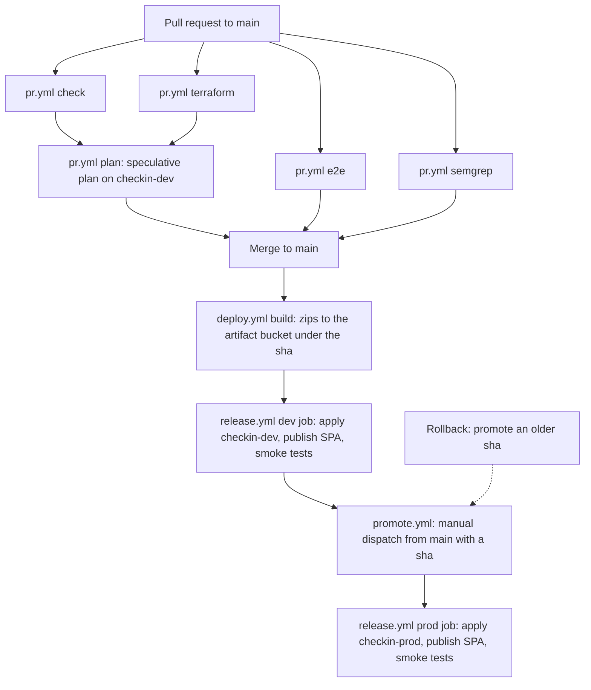

# CI/CD

GitHub Actions tests every pull request, deploys every merge on `main` to dev, and deploys a chosen sha to prod on manual dispatch. HCP Terraform applies the infrastructure. The resources themselves are in [infrastructure.md](infrastructure.md). Step-by-step procedures for deploy, promote and rollback are in [runbook.md](runbook.md).

## Pipeline overview

The Lambda zips are built once, on merge. Prod reuses the exact zips that dev received.



## Workflows

Four workflows live in `.github/workflows/`. All third-party actions are pinned by commit SHA, with the version in a trailing comment.

| Workflow | Trigger | Jobs | Purpose |
| --- | --- | --- | --- |
| `pr.yml` | Pull request targeting `main` | `check`, `e2e`, `terraform`, `semgrep`, `plan` | Tests, static checks and a dev plan. |
| `deploy.yml` | Push to `main` | `build`, `release` | Builds the zips and deploys dev. |
| `promote.yml` | `workflow_dispatch` with input `sha` | `release` | Deploys a sha to prod. |
| `release.yml` | `workflow_call` | `unknown-env`, `dev`, `prod` | Shared deploy logic for both environments. |

### pr.yml

Runs on every pull request to `main` with read-only `contents` permission.

| Job | What it does |
| --- | --- |
| `check` | Runs `npm run lint`, `typecheck`, `test:unit`, `test:integration`, `build` and `web:build`. A `motoserver/moto` service container backs the integration tests through `MOTO_ENDPOINT`. |
| `e2e` | Builds the SPA and runs the Playwright suite on Chromium against `vite preview`. The tests mock every `/api/` call. |
| `terraform` | Runs `terraform fmt -check -recursive infra`, then `terraform init -backend=false` and `terraform validate` in `infra/envs/dev`, `infra/envs/prod` and `infra/bootstrap`. |
| `semgrep` | Runs `semgrep scan --config auto --error` in the `semgrep/semgrep` container. Any finding fails the job. The JSON report is uploaded as the artifact `semgrep`, even on failure. |
| `plan` | Needs `check` and `terraform`. Uploads `infra` to `checkin-dev` as a speculative configuration, runs a plan-only run, and comments the add, change and destroy counts on the PR. |

The `plan` job writes the PR head sha as `artifact_version`. No zip exists for that sha, but a plan does not read the zips. No PR job plans prod.

Deliberate Semgrep exceptions use `nosemgrep` comments; see [infrastructure.md](infrastructure.md#semgrep-exceptions).

### deploy.yml

Runs on every push to `main`.

1. `build` assumes the deploy role and runs `npm ci && npm run build`.
2. `build` copies every `dist/functions/*.zip` to `s3://<artifacts-bucket>/<sha>/`.
3. `release` calls `release.yml` with `env: dev`, `workspace: checkin-dev` and the pushed sha.

### promote.yml

Runs on manual dispatch with a required `sha` input. The `release` job runs only when the workflow ref is `refs/heads/main`. It calls `release.yml` with `env: prod`, `workspace: checkin-prod` and the input sha.

The sha must already have artifacts in the bucket. In practice, it must be a `main` sha that `deploy.yml` built. Pass the full 40-character sha: the artifact check matches the `<sha>/` prefix exactly.

### release.yml

A reusable workflow with three inputs: `env`, `workspace` and `sha`. It requires the secrets `TF_API_TOKEN` and `AWS_DEPLOY_ROLE_ARN`.

| Job | Runs when | Notes |
| --- | --- | --- |
| `unknown-env` | `env` is neither `dev` nor `prod` | Fails immediately. |
| `dev` | `env == 'dev'` | No GitHub Environment. The OIDC subject is the branch ref. |
| `prod` | `env == 'prod'` | `environment: prod`. The OIDC subject is `environment:prod`. |

The `dev` and `prod` jobs are identical except for `environment: prod`. GitHub cannot make `environment` conditionally absent, so the jobs are duplicated. Any change to one job must go to the other in the same PR.

The callers pass secrets explicitly instead of `secrets: inherit`, because Semgrep's `auto` config flags `secrets: inherit`.

## Release steps

Each `dev` or `prod` job runs these steps in order. Any failure stops the release.

1. **Checkout** the repository at `inputs.sha`.
2. **Assume** the role in `AWS_DEPLOY_ROLE_ARN` through GitHub OIDC.
3. **Check artifacts.** For every directory in `apps/functions/` at that sha, `s3://$ARTIFACTS_BUCKET/<sha>/<directory>.zip` must exist. Otherwise the error says to run deploy for the sha first.
4. **Check environment exists at sha.** `infra/envs/<env>` must exist at that sha.
5. **Write the version.** `infra/envs/<env>/artifact.auto.tfvars` gets `artifact_version = "<sha>"`.
6. **Upload** the whole `infra` folder as a configuration version to the workspace.
7. **Create a run** in the workspace.
8. **Apply** the run, but only if HCP marks it confirmable. A run with no changes skips this step.
9. **Read web outputs.** The job queries the HCP API for the workspace's current state outputs. It needs `web_bucket`, `distribution_id`, `web_url`, `admin_client_id`, `auth_domain` and `api_endpoint`.
10. **Build the SPA** with `npm ci && npm run web:build`. `VITE_COGNITO_CLIENT_ID` and `VITE_COGNITO_DOMAIN` come from the outputs.
11. **Sync the SPA.** `aws s3 sync apps/web/dist` to the web bucket with `--delete`, excluding `index.html`. Then `index.html` is uploaded alone with `Cache-Control: no-cache`.
12. **Invalidate** `/index.html` on the distribution.
13. **Smoke test.** `GET <web_url>/api/health` must return `ok: true`.
14. **Check security headers.** `GET <web_url>/` must return `Strict-Transport-Security` and `Content-Security-Policy`.
15. **Check direct API access is denied.** `GET <api_endpoint>/api/health` must return 403.

The SPA is not stored as an artifact. Each release rebuilds it from the source at the sha.

Promoting an older sha reverts code and versioned infrastructure only. Data does not revert.

The KMS key policy has its own rollback caveat; see [infrastructure.md](infrastructure.md#kms-key). So does the prod custom domain; see [infrastructure.md](infrastructure.md#custom-domain).

## Secrets and variables

Jobs without a GitHub Environment read all four values, so they are set at repository level.

| Name | Kind | Used by | Value |
| --- | --- | --- | --- |
| `TF_API_TOKEN` | Actions secret and Dependabot secret | `pr.yml` `plan`, `release.yml` | HCP user API token |
| `AWS_DEPLOY_ROLE_ARN` | Actions secret | `deploy.yml` `build`, `release.yml` | Bootstrap output `github_deploy_role_arn` |
| `TF_CLOUD_ORGANIZATION` | Actions variable | `pr.yml` `plan`, `release.yml` | `ATS_org` |
| `ARTIFACTS_BUCKET` | Actions variable | `deploy.yml` `build`, `release.yml` | Bootstrap output `artifacts_bucket` |

`TF_API_TOKEN` must be an HCP user API token. Organization tokens and GitHub App tokens fail the upload with `unauthorized`. The token owns every workspace, prod included; see [infrastructure.md](infrastructure.md#dev-deny-prod-policy).

Dependabot pull requests cannot read Actions secrets. The `plan` job therefore needs `TF_API_TOKEN` stored as a Dependabot secret too.

The HCP workspaces hold their own environment variables (`TFC_AWS_PROVIDER_AUTH`, `TFC_AWS_RUN_ROLE_ARN`); see [infrastructure.md](infrastructure.md#hcp-terraform).

## Artifacts

Lambda zips live in the bootstrap bucket `checkin-artifacts-<account-id>-us-east-1`:

```text
s3://<artifacts-bucket>/<sha>/<function>.zip
```

`<sha>` is the full commit sha of the `main` push. `<function>` is a directory name under `apps/functions/`: `api-admin`, `api-public`, `api-user`, `authorizer-user`, `checkin-worker`, `cognito-post-auth`.

In CI, only `deploy.yml` writes artifacts. A lifecycle rule deletes every object 90 days after upload. Both environments read from the same bucket.

### Rollback window

A rollback is a promote of an older sha. The sha must meet two conditions:

- It is a `main` merge sha at or after commit `c98cfd4`, the first commit with `infra/envs/prod`. Older shas fail at "Check environment exists at sha".
- Its artifacts are at most 90 days old. Older shas fail at "Check artifacts".

## Prod approval model

The GitHub Environment `prod` restricts deployments to the `main` branch. It has no required reviewer, by deliberate choice: the project has a single maintainer. Dispatching `promote.yml` is the approval. This is an accepted risk.

Two guards keep prod deploys on `main`:

- The `prod` Environment branch rule. The OIDC subject `environment:prod` carries no branch, so the deploy role trust cannot check it.
- The `if: github.ref == 'refs/heads/main'` condition in `promote.yml`.

A local `terraform apply` in `infra/envs/prod` after `terraform login` bypasses both guards.

## Concurrency

| Workflow | Concurrency group |
| --- | --- |
| `deploy.yml` | `deploy-dev` |
| `promote.yml` | `deploy-prod` |

Neither group cancels in-progress runs. Each group keeps at most one pending run, and a newer pending run cancels the older one.

- Dispatching several promotes at once cancels the queued ones. Run promotes one at a time.
- A cancelled pending deploy never runs its `build` job. Its sha has no artifacts and cannot be promoted.

`pr.yml` has no concurrency group.

## Dependabot

The policy is in [`.github/dependabot.yml`](../.github/dependabot.yml); the reasons are in [ADR 0018](adr/0018-dependency-update-policy.md).

### Manual bumps

Dependabot does not update these versions. Bump them by hand:

| Item | Where |
| --- | --- |
| moto service image | `services.moto` in `.github/workflows/pr.yml` |
| Semgrep container image | `container` of the `semgrep` job in `.github/workflows/pr.yml` |
| Terraform core | `required_version` in the three roots, `terraform_version` in `.github/workflows/pr.yml`, and the HCP workspace setting |

Dependabot bumps moto in `tests/docker-compose.yml`. When it does, bump `pr.yml` in the same PR so both run the same moto version.

The root `compose.yml` also pins moto and `node:24-slim`. It sits outside the Dependabot `docker-compose` directory `/tests`.
