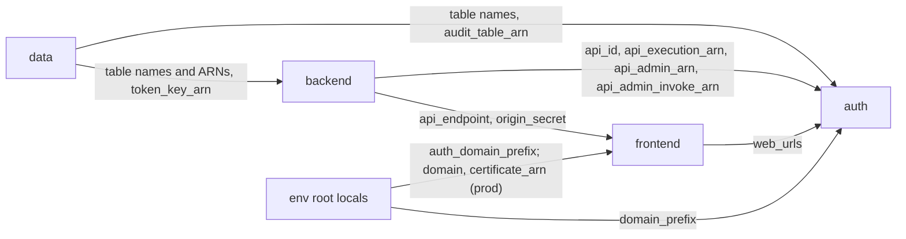
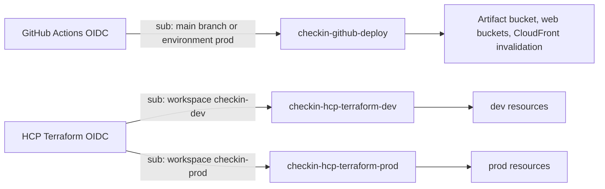

# Infrastructure

Terraform under `infra/` defines every AWS resource. All roots set the AWS provider region to `us-east-1`. HCP Terraform stores the state and runs the plans. CI drives the dev and prod runs; see [ci-cd.md](ci-cd.md). For the system view, see [architecture.md](architecture.md). For operational procedures, see [runbook.md](runbook.md).

This page keeps the decisions and gotchas. The `.tf` files are the record for inputs, outputs, settings and permissions.

## Overview

The stack is serverless. Each environment (`dev`, `prod`) gets its own copy of every resource.

- CloudFront serves the SPA from S3 and proxies `/api/*` to an API Gateway HTTP API.
- Six Lambda functions run the API, the user authorizer, the check-in worker and a Cognito trigger.
- DynamoDB holds two tables: `checkin-<env>-main` and `checkin-<env>-audit`.
- EventBridge Scheduler invokes the worker. The application creates the schedules at runtime.
- KMS encrypts the stored Tecnofit tokens.
- Cognito authenticates the admin.
- CloudWatch alarms notify an SNS topic by e-mail.

One shared bootstrap root creates the artifact bucket and the CI roles for both environments.

## Terraform roots

Three roots exist. Each root maps to one HCP Terraform workspace.

| Root | Workspace | Owns |
| --- | --- | --- |
| `infra/bootstrap` | `checkin-bootstrap` | Artifact bucket, HCP OIDC provider, GitHub deploy role, HCP run roles for dev and prod. |
| `infra/envs/dev` | `checkin-dev` | All dev resources, through the four modules. |
| `infra/envs/prod` | `checkin-prod` | All prod resources, through the four modules. |

### Bootstrap

`infra/bootstrap/main.tf` reads the existing GitHub OIDC provider and never creates it. The artifact bucket expires objects after 90 days.

Always apply the bootstrap with `-var hcp_project=tecnofit-auto-checkin`. The default, `Default Project`, breaks the trust of both HCP roles.

### Environments

`infra/envs/dev` and `infra/envs/prod` are identical except for the environment name and the prod [custom domain](#custom-domain). Their only variable is `artifact_version`, the git sha of the Lambda zips. CI sets it; see [ci-cd.md](ci-cd.md#release-steps).

Each env root sets `alarm_email` and `operator_arns` as literals in its `main.tf`.

## Modules

Four modules under `infra/modules/` build each environment.

| Module | Owns |
| --- | --- |
| `data` | DynamoDB tables, KMS token key and alias. |
| `backend` | Worker and API Lambdas, HTTP API, user authorizer, public and user routes, Scheduler group and role, origin secret, SNS topic, metric filters, alarms. |
| `frontend` | Web bucket, CloudFront distribution and its function and policies. |
| `auth` | Cognito user pool, domain and web client, `cognito-post-auth` Lambda, JWT authorizer, admin routes. |

### Module dependencies

The env root wires the modules together. Arrows point from the producer to the consumer.



The admin routes, the JWT authorizer and Cognito live in `auth`, not in `backend`. The reason is a dependency cycle:

- The Cognito app client needs the CloudFront URLs for its callback and logout URLs.
- `frontend` needs `backend` for the API origin and the origin secret.
- Cognito in `backend` would make `backend` depend on `frontend`, which already depends on `backend`.

`auth` therefore sits after both. The `api-admin` Lambda itself stays in `backend`. `auth` only adds its routes, its integration and its invoke permission.

The CSP in `frontend` must name the Cognito domain. The env root computes the domain prefix as a local and passes it to both `frontend` and `auth`. `frontend` thus never depends on `auth`.

## Pinned versions

| Component | Version | Where |
| --- | --- | --- |
| Terraform core | `= 1.15.9` | `required_version` in all three roots; `terraform_version` in `.github/workflows/pr.yml`; HCP workspace setting. |
| Lambda runtime | `nodejs24.x` | `infra/modules/backend/main.tf`, `infra/modules/auth/main.tf`. |
| Bundle target | `node24` | `scripts/build-functions.mjs`. |

Each root commits its `.terraform.lock.hcl`. The lock files are the record for provider versions. Dependabot does not bump the Terraform core version; see [ci-cd.md](ci-cd.md#dependabot).

## Naming conventions and tags

Resource names follow `checkin-<env>-<name>`. Exceptions and variants:

| Resource | Name |
| --- | --- |
| Artifact bucket (shared) | `checkin-artifacts-<account-id>-us-east-1` |
| Web bucket | `checkin-<env>-web-<account-id>-us-east-1` |
| KMS alias | `alias/checkin-<env>-token` |
| Lambda log groups | `/aws/lambda/checkin-<env>-<function>` |
| Scheduler group | `checkin-<env>` |
| CloudFront distribution comment | `checkin-<env>` |
| Cognito domain prefix | `checkin-<env>-<account-id>` |
| Bootstrap roles | `checkin-github-deploy`, `checkin-hcp-terraform-<env>` |

The provider in each env root sets default tags on every resource: `Project = checkin` and `Env = <env>`. The bootstrap root sets no default tags.

Several policies and scripts depend on these names. Renaming a resource can break them:

- The KMS key policy builds the allowed role ARNs from `checkin-<env>-<function>`.
- The HCP IAM policies allow role management only on `role/checkin-<env>-*`.
- `checkin-dev-deny-prod` matches `checkin-prod` in ARNs and the `Env = prod` tag.
- The deploy role writes only to buckets matching `checkin-*-web-*`.
- `scripts/env.ts` derives table, alias, group, function and role names, and finds the distribution by its comment.

## HCP Terraform

All state lives in HCP Terraform: organization `ATS_org`, project `tecnofit-auto-checkin`. All three workspaces are in that project. For `checkin-dev` and `checkin-prod` this is required, because the HCP role trust names the project.

| Workspace | Working directory | Execution mode | Runs from | AWS credentials |
| --- | --- | --- | --- | --- |
| `checkin-bootstrap` | Not used | Local | Operator laptop | Operator credentials in the shell |
| `checkin-dev` | `envs/dev` | Remote | CI through the HCP API | Dynamic credentials, role `checkin-hcp-terraform-dev` |
| `checkin-prod` | `envs/prod` | Remote | CI through the HCP API | Dynamic credentials, role `checkin-hcp-terraform-prod` |

The working directory is set in the HCP UI. It is `envs/<env>`, not `infra/envs/<env>`, because CI uploads the whole `infra` folder. The upload must include `infra/modules`, which the env roots reference.

Each `cloud` block names its workspace but not the organization. Set `TF_CLOUD_ORGANIZATION=ATS_org` for any local `terraform init`.

Workspace environment variables on `checkin-dev` and `checkin-prod`:

| Variable | Value |
| --- | --- |
| `TFC_AWS_PROVIDER_AUTH` | `true` |
| `TFC_AWS_RUN_ROLE_ARN` | Bootstrap output `hcp_dev_role_arn` or `hcp_prod_role_arn` |

Terraform variables on `checkin-prod` only. Both are required, and an empty string turns Sentry off:

| Variable | Value |
| --- | --- |
| `sentry_dsn_api` | DSN of Sentry project `tecnofit-auto-checkin-api` |
| `sentry_dsn_web` | DSN of Sentry project `tecnofit-auto-checkin-web` |

## IAM and OIDC

No long-lived AWS keys exist for CI. GitHub Actions and HCP Terraform both assume roles through OIDC.



### Deploy role

`checkin-github-deploy` serves both environments. Its trust accepts two subjects:

- `repo:<github_repo>:ref:refs/heads/main`: the `deploy.yml` build job and the `release.yml` `dev` job.
- `repo:<github_repo>:environment:prod`: the `release.yml` `prod` job.

`github_repo` uses GitHub's immutable subject format, `<owner>@<owner-id>/<repo>@<repo-id>`. A renamed or recreated repository or owner no longer matches.

### HCP run roles

`checkin-hcp-terraform-dev` and `checkin-hcp-terraform-prod` trust the HCP OIDC provider with this subject pattern:

```text
organization:<hcp_org>:project:<hcp_project>:workspace:checkin-<env>:run_phase:*
```

Each role has `PowerUserAccess`. An inline policy adds role management and `iam:PassRole`, on `role/checkin-<env>-*` only.

### Dev deny-prod policy

The inline policy `checkin-dev-deny-prod` on `checkin-hcp-terraform-dev` has three deny statements:

| Sid | Denies |
| --- | --- |
| `DenyProdByName` | Any action on Lambda, DynamoDB, Logs, S3, SNS, Scheduler, CloudWatch and CloudFront ARNs containing `checkin-prod`, and on `role/checkin-prod-*`. |
| `DenyProdByTag` | Any action on resources tagged `Env = prod`. |
| `DenyArtifactWrites` | Object writes, deletes and bucket configuration on the artifact bucket. |

This policy is defense in depth, not a hard boundary. The dev role can still create `checkin-dev-*` roles with any inline policy. Also, `TF_API_TOKEN` is an HCP user API token. The HCP free plan has no teams, so that token owns every workspace, prod included. Both are accepted risks.

## KMS key

`module.data` creates `aws_kms_key.token` per environment, with alias `alias/checkin-<env>-token`. It encrypts the Tecnofit tokens. Automatic key rotation is on.

The key policy in `infra/modules/data/main.tf` has three statements:

| Sid | Effect |
| --- | --- |
| `AccountRoot` | Allows `kms:*` to the account root. |
| `TokenUseOnlyByApp` | Denies encrypt, decrypt, re-encrypt and data-key generation to every principal except the roles `checkin-<env>-checkin-worker`, `checkin-<env>-api-public`, `checkin-<env>-api-user` and the `operator_arns`. |
| `KeyAdminOnlyByOwners` | Denies policy changes, deletion scheduling, disabling, rotation changes, grants and tagging to every principal except `checkin-hcp-terraform-<env>`, the account root and the `operator_arns`. |

`operator_arns` lists the IAM user ARNs of the operators (`<operator-user>`). Operator scripts need it to encrypt and decrypt tokens.

The Lambda policies add a second guard. `kms:Encrypt` and `kms:Decrypt` require the encryption context key `userId`.

The dev HCP role has extra prod denies, with accepted risks; see [Dev deny-prod policy](#dev-deny-prod-policy).

`aws_kms_key.policy` is a computed attribute. Promoting a sha older than `7c12141`, which added this policy, leaves the current policy in place. [runbook.md](runbook.md#kms-key-access) covers how to reset it.

## DynamoDB

`module.data` creates two tables per environment: `checkin-<env>-main` and `checkin-<env>-audit`. Both share the same settings:

- On-demand billing (`PAY_PER_REQUEST`).
- String keys `PK` (hash) and `SK` (range).
- Two global secondary indexes, `GSI1` (`GSI1PK`, `GSI1SK`) and `GSI2` (`GSI2PK`, `GSI2SK`), projecting all attributes.
- TTL on the attribute `ttl`.
- Deletion protection and point-in-time recovery enabled.
- Server-side encryption with the AWS-managed key.

The item layout is in [data-model.md](data-model.md).

## Lambda

Six functions exist per environment. Their code lives in `apps/functions/<name>/index.ts`.

| Function | Module | Timeout | Trigger |
| --- | --- | --- | --- |
| `checkin-<env>-checkin-worker` | `backend` | 180 s | EventBridge Scheduler |
| `checkin-<env>-api-public` | `backend` | 15 s | API Gateway, public routes |
| `checkin-<env>-api-user` | `backend` | 15 s | API Gateway, user routes |
| `checkin-<env>-api-admin` | `backend` | 15 s | API Gateway, admin routes (wired in `auth`) |
| `checkin-<env>-authorizer-user` | `backend` | 15 s | API Gateway REQUEST authorizer |
| `checkin-<env>-cognito-post-auth` | `auth` | 15 s | Cognito post-authentication trigger |

All functions use 256 MB, X-Ray active tracing and a Terraform-managed log group with 30-day retention. Each has its own role and inline policy, named `checkin-<env>-<name>`. Code comes from `s3://<artifacts-bucket>/<artifact_version>/<name>.zip`.

Per-function environment variables and IAM permissions are in `local.api_functions` in `infra/modules/backend/main.tf`. The worker and `cognito-post-auth` declare theirs explicitly. All six also get `SENTRY_DSN` when the module's `sentry_dsn` is set (prod only).

`scripts/build-functions.mjs` builds one zip per directory in `apps/functions/`. It bundles `index.ts` with esbuild into an ESM `index.mjs`, then zips it.

The worker has an async invoke config with 0 retries and a maximum event age of 60 s. The schedules set the same retry policy on their target.

## API Gateway

`module.backend` creates the HTTP API `checkin-<env>-api` with an auto-deployed `$default` stage. All integrations are `AWS_PROXY` with payload format 2.0.

The API has no CORS configuration: the SPA calls it through the same CloudFront origin.

Public and user routes are in `local.routes` in `infra/modules/backend/main.tf`. Admin routes are in `local.routes` in `infra/modules/auth/main.tf`. The route list is in [openapi.yaml](openapi.yaml). User routes use the Lambda REQUEST authorizer; admin routes use the Cognito JWT authorizer.

The origin secret is `random_password.origin` in `module.backend`. [runbook.md](runbook.md#origin-secret-rotation) covers its rotation. Throttling limits are in [api.md](api.md#throttling).

## EventBridge Scheduler

`module.backend` creates the schedule group `checkin-<env>` and the role `checkin-<env>-scheduler-invoke`, which may only invoke the worker.

Terraform creates no schedules. The application creates one schedule per booking at runtime, in `packages/core/domain/schedules.ts`. The operator scripts `scripts/schedule.ts` and `scripts/migrate.ts` also create schedules. Terraform state does not track them, and deleting the group deletes all schedules in it.

## CloudFront

`module.frontend` creates one distribution per environment, with comment `checkin-<env>`. It serves the web bucket through origin access control and forwards `/api/*` to the API with the `X-Origin-Verify` header. Settings are in `infra/modules/frontend/main.tf`.

The response headers policy `checkin-<env>-web` sets the CSP. The CSP allows `connect-src` to the Cognito domain so the admin SPA can call the token endpoint. When `sentry_dsn` is set, it also allows the Sentry ingest host taken from the DSN.

### Custom domain

Prod serves `checkin.alexandresilvestri.com.br` as an alias, next to its default `*.cloudfront.net` domain. Dev has only the default domain.

- The certificate is the ACM certificate `*.alexandresilvestri.com.br` in `us-east-1`. It is created and DNS-validated outside Terraform. The prod root reads it with `data "aws_acm_certificate"`, so no ARN is committed.
- With a custom domain, the viewer certificate uses `sni-only` and minimum TLS `TLSv1.2_2021`. Dev keeps the default certificate, which cannot set a minimum TLS version, hence the `nosemgrep` on the distribution.
- The `frontend` output `web_urls` lists the default domain and every alias. `auth` builds the Cognito callback and logout URLs from it, so the admin can log in on both domains. The `web_url` output stays the CloudFront domain, which the release smoke tests use.

Change the alias only in Terraform. A console change is drift: the next apply reverts it, and Cognito answers `redirect_mismatch` for any domain missing from the callback URLs.

Rollback caveat: promoting a sha older than this setup removes the alias and the certificate. The CloudFront domain keeps working.

## Cognito

`module.auth` creates the admin user pool `checkin-<env>-admin`. Only the admin uses it; app users log in with their Tecnofit credentials. Only administrators create users, and MFA with TOTP is required. The app client accepts `<url>/admin/callback` and `<url>/admin` for every URL in `web_urls`. Settings are in `infra/modules/auth/main.tf`.

## Alarms and SNS

`module.backend` creates the SNS topic `checkin-<env>-alarms` with one e-mail subscription to `<alarm-email>`. The subscription must be confirmed once per environment. Every alarm notifies this topic.

Two log metric filters feed the custom metrics:

- `checkin-<env>-checkin-failed` on the worker log group: `{ $.message = "checkin" && $.status = "failed" }`.
- `checkin-<env>-login-failed` on the `api-public` log group: `{ $.message = "request" && $.route = "/api/auth/login" && $.status = 401 }`.

The alarm list and the response to each alarm are in [runbook.md](runbook.md#alarms).

## Semgrep exceptions

The PR pipeline runs Semgrep with `--config auto --error`, so any finding fails the build. A deliberate exception carries two comment lines directly above the flagged code:

```hcl
# Logs hold only ids and statuses; AWS-managed encryption is enough.
# nosemgrep: terraform.aws.security.aws-cloudwatch-log-group-unencrypted.aws-cloudwatch-log-group-unencrypted
```

The first line justifies the exception. The second names the exact rule IDs. `rg -n nosemgrep infra` lists the current exceptions.

## Adding infrastructure

Checklists are in [development.md](development.md): [adding an API route](development.md#adding-an-api-route), [adding a Lambda](development.md#adding-a-lambda) and [adding infrastructure](development.md#adding-infrastructure).
